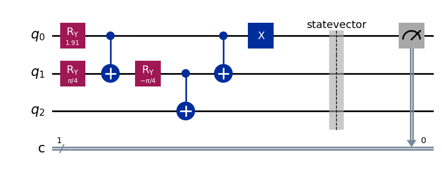
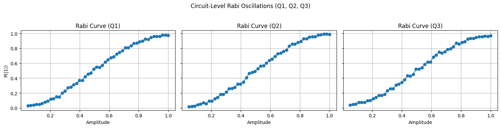
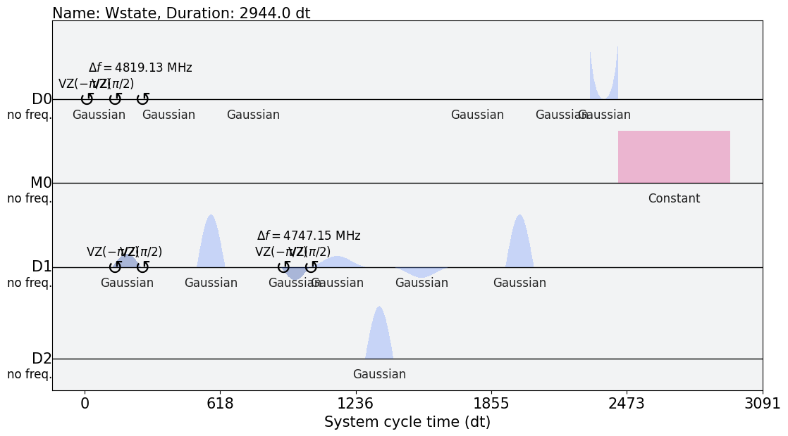

# W-State Preparation with Qiskit Pulse

Prepares the three-qubit W state

$$|W\rangle = \tfrac{1}{\sqrt{3}}\left(|001\rangle + |010\rangle + |100\rangle\right)$$

first as a gate-level circuit, then as a pulse schedule built from `ibm_sherbrooke` calibration data (physical qubits 1–3). Unlike a GHZ state, a W state keeps bipartite entanglement when one qubit is lost, which makes it useful for secret sharing and teleportation over noisy links.

| Notebook | What it does | Environment |
| --- | --- | --- |
| [`notebooks/w_state_circuit.ipynb`](notebooks/w_state_circuit.ipynb) | Two gate-level W-state circuits, checked against the exact statevector; then reads T₁, T₂, readout error, and drive frequencies from the backend and saves them to [`data/wstate_backend_params.json`](data/wstate_backend_params.json). | [`requirements-circuit.txt`](requirements-circuit.txt) (Qiskit 2.x) |
| [`notebooks/w_state_pulse.ipynb`](notebooks/w_state_pulse.ipynb) | Estimates π-pulse amplitudes per qubit, defines pulse-level RY, X, cross-resonance CNOT, and measurement blocks, and assembles the full W-state schedule. | [`requirements-pulse.txt`](requirements-pulse.txt) (Qiskit 0.46) |

The two notebooks need different Qiskit versions because Qiskit Pulse was removed in Qiskit 1.0.

## Run it

```bash
git clone https://github.com/syedshubha/w-state-qiskit-pulse
cd w-state-qiskit-pulse

python -m venv .venv-pulse && source .venv-pulse/bin/activate
pip install -r requirements-pulse.txt jupyter
jupyter notebook notebooks/w_state_pulse.ipynb
```

Use `requirements-circuit.txt` in a separate environment for the circuit notebook. Each notebook also has an **Open in Colab** badge; in Colab the first cells install the same pinned versions and fetch the calibration snapshot from this repository.

The calibration snapshot in `data/` lets the pulse notebook run without an IBM Quantum account. Only the final cells of the circuit notebook, which fetch live calibration data, need `qiskit-ibm-runtime` and an account.

## Results

**Gate-level circuit.** Both constructions start with `RY(2 arccos(1/√3))` on q0, then a controlled-RY(π/2) (native in the first, decomposed into RY–CNOT–RY in the second), two CNOTs, and an X on q0. Each returns amplitude 1/√3 on |001⟩, |010⟩, and |100⟩ and zero elsewhere.



**π-pulse estimates.** Each qubit is swept over `RX(πA)` for 50 amplitudes A, with that qubit's T₁/T₂ relaxation and readout error from the snapshot, at 1,024 shots per point. The ideal π amplitude is therefore A = 1; the noisy argmax lands at 0.96–1.00 and shifts slightly from run to run because of shot noise. This is a circuit-level stand-in for a pulse Rabi experiment.



**Pulse schedule.** Single-qubit rotations are 128-sample Gaussian pulses (σ = 64) scaled from the π amplitudes, with RY implemented as phase-shifted X drives. Each CNOT is a cross-resonance sequence: a Gaussian CR pulse on the control at the target's drive frequency, a π pulse on the target, then a CR pulse with negated amplitude. The full schedule runs 2,944 samples (dt = 0.222 ns).



## Scope and limitations

- The schedule is assembled and drawn but not simulated or run on hardware. CR amplitude and duration are set by hand rather than calibrated, so the schedule shows the structure of a pulse-level W-state preparation, not a tuned implementation.
- `ibm_sherbrooke` reported no calibrated `cx` gates when the snapshot was taken, so CNOT timing could not be read from the backend.

## Write-up

The full report, with derivations and discussion, is in [`docs/w-state-report.pdf`](docs/w-state-report.pdf). The project was completed for PHYS 4750 (Quantum Technology) at Louisiana State University in 2025.

## Author

[Syed Emad Uddin Shubha](https://syedshubha.com), Louisiana State University
